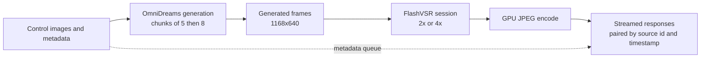
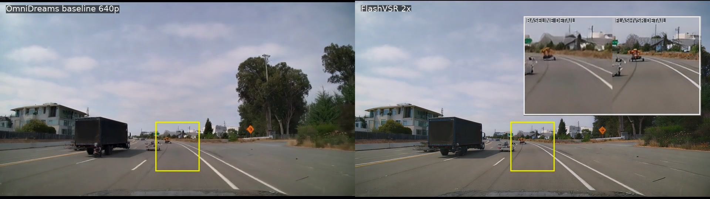

<!-- SPDX-FileCopyrightText: Copyright (c) 2026 NVIDIA CORPORATION & AFFILIATES.
 All rights reserved. -->

<!-- SPDX-License-Identifier: Apache-2.0 -->

# Adding a Fidelity Stage to a Streaming World Model: FlashVSR in the N3BULA Service

## Abstract

OmniDreams generates 1168x640 frames at interactive rates. This note describes how
[FlashVSR](flashvsr.md), a one-step streaming video super-resolution (VSR) model, was integrated into
the [N3BULA gRPC service](n3bula.md) as an optional post-processing stage that enlarges each
generated frame by 2x or 4x before it is encoded and streamed. The integration works: frames arrive
sharper, correctly paired with their request metadata, and at a larger resolution. It is also
slow. On a single workstation GPU the stage drops delivered throughput from about 17 FPS to about
4 FPS, so it ships as an opt-in feature that is off by default. This is a slow result, not a failed
one, and the engineering around it is a useful template for adding any fidelity model (restoration,
upscaling, color or temporal refinement) behind a streaming generator.

## At a glance

| | VSR off (default) | FlashVSR 2x on |
| --- | --- | --- |
| Output resolution | 1168x640 | 2304x1280 |
| Delivered throughput (live service) | about 17.4 FPS | about 3.9 FPS steady |
| Added cost per 8-frame chunk | none | about 1.2 to 1.3 s |
| Model memory | baseline | adds a second resident model |
| How to enable | default | `N3BULA_ENABLE_FLASHVSR=1` or `--enable-flashvsr` |

Measured on one NVIDIA RTX PRO 6000 Blackwell workstation GPU with the prepared `omnidreams-perf`
configuration at `640p`. Numbers are for the 2x path. The 4x path is supported by the same
option but was not benchmarked, and should be expected to cost more than 2x.

## Background

The N3BULA service receives scene control images over gRPC, runs OmniDreams generation in chunks
(a first chunk of 5 frames, then 8 frames per chunk), JPEG-encodes the result on the GPU and streams
it back, pairing every response with the source frame id and timestamp of its request.

Generation resolution is a quality and cost lever: higher resolutions cost more per denoising step.
A VSR stage offers a different trade. Generate at 640p, then spend a separate, much smaller model's
compute to reach roughly 1280p.

## Design



Key integration points:

- **Opt-in session.** The service builds a FlashVSR session at startup only when enabled. The
  resolved output size is reported by the engine, so clients and the encoder agree on dimensions.
- **Scale and sparsity knobs.** `--flashvsr-scale {2,4}` selects the factor and
  `--flashvsr-sparse-ratio {1.5,2.0}` selects the sparse-attention ratio. Ratio 1.5 is about 8%
  faster than 2.0 with a mean absolute difference of about 0.5/255 on measured frames.
- **Metadata pairing.** Requests are queued as frames are submitted and restored frames are matched
  back to them, so source frame ids and timestamps survive the extra stage.
- **Tail flush.** VSR is stateful and can hold frames back. When a stream ends, the service drains
  the stage so no trailing frames are lost.
- **Reset on new streams.** Session state is reset between scenes so one stream cannot leak
  temporal context into the next.
- **Image prebuild.** The color-correction kernel is built into the container image rather than
  compiled on first use, and persistent compiler caches keep restart cost predictable.

## Resolution behavior

FlashVSR supports integer scales of 2 and 4 only; there is no 1x or fractional mode. The output
size is `((input * scale) // 128) * 128` per axis, so a 1168x640 input at 2x produces 2304x1280
rather than 2336x1280: the model trims 16 pixels from each side. Clients that overlay or compare
against the source must account for this, and any comparison against a plain bilinear upscale
should crop the same border.

## Side-by-side comparison

Left: the OmniDreams 640p output. Right: FlashVSR 2x. The still below is taken from the
timestamp-matched 30 fps comparison, with the same roadway region enlarged in both panels.



The timestamp-paced 30 fps portrait clip below stacks matched OmniDreams baseline frames above
FlashVSR 2x. The full N3BULA control input appears in the baseline panel; a separate inset compares
the same road detail from the baseline and FlashVSR outputs. Yellow boxes show that output crop.

<video controls preload="metadata" style="max-width: 100%; height: auto;">
  <source src="../_static/model_clips/n3bula/flashvsr-2x-vertical-stack-30fps.mp4" type="video/mp4">
  Your browser does not support embedded video.
</video>

[Download the 30 fps portrait comparison video](../_static/model_clips/n3bula/flashvsr-2x-vertical-stack-30fps.mp4).

Both inset panes show the same road-level 120 x 135 source region at x=420, y=420. The baseline
crop is enlarged to 240 x 270. The FlashVSR crop uses the corresponding 240 x 270 output region,
mapped around the model's 16-pixel side trim.

The run was requested at 30 Hz and recorded 900 frames, but their timestamps span 35.97 seconds
and include gaps. Forcing 900 samples into 30 seconds made playback appear accelerated. The clip
preserves the source-time spacing and resamples to constant 30 fps: it is 36.03 seconds long with
1081 frames. Two black FlashVSR outputs (source IDs 4412 and 4413) are omitted; the affected time
interval is held on the preceding valid image. The baseline produced 900 clean frames.

What the comparison shows:

- Distant trees, lane markings and horizon structure appear more defined than with interpolation;
  this is a visual impression, not evidence that the synthesized detail matches scene truth.
- Fine structure on nearby objects is sharpened, but the model also invents texture where the
  generator left only a smear. Small repeated patterns, such as on license plates, should be
  treated as plausible detail, not recovered signal.
- VSR does not repair generation errors. Geometry or identity mistakes in the 640p frame are
  preserved at higher resolution.

Quality was judged visually and with coarse distance metrics. No temporal-fidelity validation was
done on long contiguous sequences, and these frames are not ground truth.

### Sky appearance

The scene-control images contain road geometry but no sky pixels. The actor-free seed image has a
soft, lightly clouded sky; despite an explicit clear-sky prompt, generated frames develop dense,
repeating cloud texture in both the parent and responsive profiles. This points to sky appearance
being synthesized by OmniDreams rather than copied from the controls. FlashVSR can make existing
texture more conspicuous, but it is not the origin of the clouds. The single-seed comparison does
not isolate whether the seed, prompt adherence, temporal history or their interaction dominates;
there is no sky ground truth for a fidelity score.

### Responsive-profile comparison

This separate A/B uses the same 640p controls, recording, seed image, prompt and RNG seed for both
`omnidreams-optimized-rtx-pro-6000` and
`omnidreams-optimized-rtx-pro-6000-responsive`. FlashVSR is disabled in both runs so the profile
change is isolated. Both runs cover source IDs 4506-4745; matching source timestamps do not guarantee
that independently generated scenes remain visually aligned. The first output frame is identical,
but later frames diverge, so use this as a qualitative profile-behavior check rather than a
per-frame fidelity comparison.

On this single 240-frame run, steady end-to-end throughput was 12.44 FPS for the parent and
13.42 FPS for the responsive profile; generate-only throughput was 20.80 and 23.68 FPS,
respectively. The first response took 7.23 s and 2.17 s, respectively. These single-run numbers
are exploratory, not a quality or latency guarantee; repeated seeds, profile-specific quality
scoring, GPU memory and flicker analysis remain outstanding.

## Learnings

### Throughput

1. **A serial stage sets the delivered rate.** Generation and restoration run one after the other
   on the same GPU. Generation alone sustains about 17 FPS (about 350 ms per 8-frame chunk). The
   restoration stage costs roughly 1.2 to 1.3 s per chunk, so delivered throughput is set by their
   sum, not by the faster of the two.
2. **Do not compare headline numbers across hardware.** Published VSR speeds use other GPUs and
   resolutions. Measure on the target GPU, at the real input size, on real generated frames.
3. **Sparse ratio is a cheap speedup.** Ratio 1.5 versus 2.0 saved about 8% per 8-frame chunk
   (about 1.17 s versus 1.27 s) at a mean absolute difference of about 0.5/255.

### Chunk size

4. **Larger VSR chunks barely help steady state.** At ratio 1.5, a 16-frame chunk ran at about
   6.6 FPS versus about 6.5 FPS for 8 frames, a gain of under 2%. The per-frame cost is dominated
   by the model, not by per-chunk overhead, so there is little to amortize.
5. **Larger chunks hurt latency and cold start.** The first 16-frame chunk took about 4.2 s versus
   about 2.6 s for 8 frames, and a consumer must wait for the whole chunk before any frame is
   delivered.
6. **Chunk size changes the output.** The same frames restored with 8 versus 16 frame chunks
   differed by a mean absolute error of about 3.1/255, much more than the sparse-ratio change,
   because the model carries temporal context across a chunk. Treat chunk size as a quality
   parameter and compare outputs when changing it.
7. **Align VSR chunks with the generator schedule.** The generator emits 5 frames and then 8 per
   chunk. Feeding each generated chunk straight to the restorer avoids buffering frames across
   chunks. A larger VSR chunk would hold frames back and add at least a generation chunk of
   latency in a streaming setting. The chosen default is 8.

### Closed-loop performance

8. **In a chunk-gated loop, chunk period is frame latency.** The live measurements were taken in
   closed-loop replay: the client releases the next generation chunk only after the previous
   chunk's frames have come back. With VSR off, the 8-frame chunk period is about 0.46 s
   (about 17.4 FPS). With VSR on at ratio 2.0, it is about 2.04 s (about 3.9 FPS, 3.55 FPS
   including cold start). Every frame in a chunk therefore pays roughly the full period before the
   next chunk can start.
9. **The loop cannot hide the restorer.** Because the next chunk waits on the previous one, a
   serial restorer adds directly to the period and cannot be overlapped with the generation it
   depends on. Overlap helps only if the consumer can feed back from pre-restoration frames, so
   that restoration is off the control path. Throughput measured open loop, with no gating, will
   overstate what a closed-loop client sees.
10. **Isolated stage timings do not sum to the live period.** An isolated FlashVSR chunk costs
    about 1.2 s and generation about 0.35 s, which is less than the observed 2.04 s period. The
    remaining time, including control preprocessing, copies and encode, was not fully attributed.
    Measure the live loop end to end rather than adding up component benchmarks.

### Correctness

11. **Expect temporal latency in stateful VSR.** In one open-loop probe, a restored frame matched
    an input roughly four frames earlier in time, and the first five outputs were nearly static.
    This was observed on a single window and not root-caused. Anything that overlays or labels
    frames by position should pair by metadata and validate alignment with a tracked feature.
12. **Probe with real, post-startup frames.** Warm-up frames differ statistically from steady
    state; first chunks can be unrepresentative.
13. **Compiler and graph capture can silently corrupt output.** Enabling both model compilation
    and CUDA graph capture produced dark or blurry first steady chunks after preparation. Both
    are now off by default and available behind `N3BULA_FLASHVSR_COMPILE=1`. Leaving them off
    also avoids roughly 97 s of compile warm-up.
14. **Stateful stages need lifecycle handling.** Pairing, tail flush and per-stream reset are
    required for correctness, not optimization.

### Media and comparison

15. **Preserve recorded timestamps when making a fixed-rate movie.** Frame count alone does not
  determine elapsed time. This 900-frame run spans 35.97 seconds in its manifest; assigning
  every frame 1/30 second compresses it to 30 seconds and accelerates motion. Build frame
  durations from manifest timestamps, then resample to constant 30 fps for playback.
16. **Treat apparent sharpness as a qualitative result.** The paired inset makes differences in
  vehicle edges and lane markings easier to inspect, but no RGB ground truth exists for this
  generated scene. A crisper result is not, by itself, evidence of higher fidelity.

### Operations

17. **Memory headroom matters.** A resident second model, plus activations at 2x, raised peak GPU
    memory substantially. Plan for headroom, and stop idle services before profiling on the same
    device.
18. **Prebuild what you can.** Building custom kernels and warming caches during image build
    removes first-request stalls.
19. **Ship it off by default while it is slow.** The code path is tested and the flags are
    documented, so adopting it later is a configuration change.

### Why this is not a failed experiment

The integration met its functional goals: correct pairing, correct output size, clean tail drain,
no corruption once compile and graph capture were disabled, and visibly sharper output. Fidelity
cannot be established from this generated scene without ground truth. What it did not meet is a
real-time budget on this GPU. That is a property of a serial pipeline and a
heavy-ish restoration model, not of the approach, and it points at clear next steps.

## Operating guidance

- Leave VSR off for interactive use.
- Enable it for quality-first or offline-style streams where a few FPS is acceptable.
- Use ratio 1.5 and 8-frame chunks as the starting configuration.
- Verify dimensions on the client: output is a multiple of 128 per axis.

```bash
# Opt in at run time (the container image defaults to off).
docker run --rm --gpus all \
  --publish 127.0.0.1:50051:50051 \
  --env N3BULA_ENABLE_FLASHVSR=1 \
  omnidreams-n3bula:latest
```

## Next steps

- **Overlap the stages.** Restore chunk *n* while generating chunk *n+1*, ideally on separate
  streams or devices, so throughput approaches the slower stage instead of the sum. In a closed
  loop this requires feedback from pre-restoration frames.
- **Revisit compilation safely.** Kernel compilation and graph capture could recover a large share
  of the cost once the first-chunk corruption is understood.
- **Validate temporal fidelity** on long contiguous sequences, including the latency observation
  above, and benchmark 4x.
- **Generate natively at higher resolution** and compare cost and quality against generate-then-upscale.

## Related pages

- [N3BULA gRPC service](n3bula.md)
- [NVIDIA OmniDreams](omnidreams.md)
- [FlashVSR](flashvsr.md)
