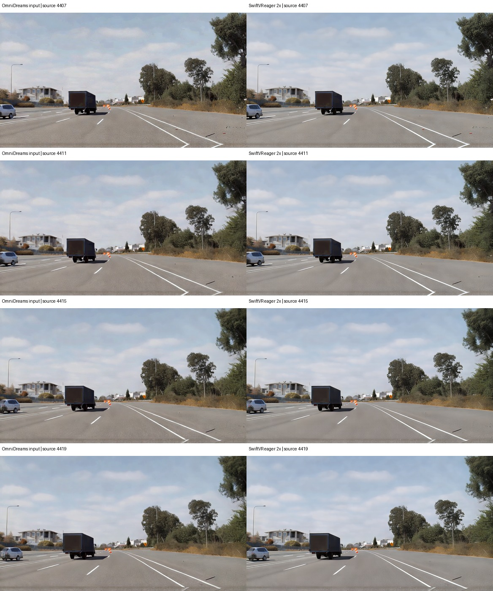

# N3BULA + SwiftVR: Offline 2x Comparison

## Summary

This note compares raw OmniDreams frames with the same frames after SwiftVR 2x restoration.
Both use the clear-sky day seed from run 0132 and the `omnidreams-fast-perf` profile.

SwiftVR is available as a FlashDreams postprocessor. It is not connected to the N3BULA gRPC
service. This test runs SwiftVR offline on saved OmniDreams frames. It does not measure an
integrated N3BULA and SwiftVR stream.

## At a glance

| | OmniDreams baseline | SwiftVR 2x |
| --- | --- | --- |
| Output size | 1168 x 640 | 2336 x 1280 |
| Frames | 900 | 896 matched frames |
| Seed | `day-seed.png` | Same generated frames |
| Postprocessing | Disabled | Eager BF16, 8-frame chunks |
| Reported rate | 23.13 FPS returned by the replay | 20.92 FPS for inference and flush |

These rates measure different work. The baseline rate includes the open-loop N3BULA replay.
The SwiftVR rate covers its inference window and flush, but excludes image staging and file writes.
They are not an end-to-end service comparison.

## Visual comparison

Each row uses the same source frame on both sides. The SwiftVR output is 2x larger.

The portrait video stacks the OmniDreams baseline above SwiftVR 2x and keeps the source timing.
It places the matched road-detail crops over the lower panel. Both inset panes show the same
road-level 120 x 135 source region at x=420, y=420. The baseline crop is enlarged to 240 x 270,
and SwiftVR uses the corresponding 240 x 270 output crop.

<video controls preload="metadata" style="max-width: 100%; height: auto;">
  <source src="../_static/model_clips/n3bula/swiftvr-2x-vertical-stack-30fps.mp4" type="video/mp4">
  Your browser does not support embedded video.
</video>

[Download the 30 fps portrait comparison video](../_static/model_clips/n3bula/swiftvr-2x-vertical-stack-30fps.mp4).

The scene and sky remain consistent in these samples. SwiftVR adds visible texture and edge detail.
There is no ground-truth RGB video for this generated scene, so this does not show that the added
detail is more accurate.

## Run details

- N3BULA run: `0132-day-seed-openloop`, camera `FWC_C`, resolution `640p`.
- OmniDreams returned 900 frames, source IDs 4407 to 5306, at 23.13 FPS over the replay.
- FlashVSR was disabled for every baseline chunk.
- SwiftVR processed the first 896 frames, source IDs 4407 to 5302. The final four baseline frames
  were not included because this probe uses full 8-frame chunks.
- SwiftVR used the `swiftvr-2x` preset, BF16, no compile, no overlap, and five warm-up chunks.
- Steady chunk time was 0.380 seconds at p50 and 0.383 seconds at p90. Preparation and prewarm
  took 17.27 seconds. The full-window inference and flush rate was 20.92 FPS.
- The probe produced 896 outputs with no blank frames, duplicates, or source-ID gaps.

The replay returned all 900 frames at 23.13 FPS, but its median response latency was 22.74 seconds
because requests ran open loop. Do not read this throughput as interactive latency.

The scene recording SHA-256 is
`bbc4972111cfdc814edbdef88a86c7e385cd50e77852aa482fbfd08d470ac74e`. The day seed SHA-256 is
`274fb815effdb77504218b6f9932dc579719014d14bc899ac2cf11153bbf04f6`.